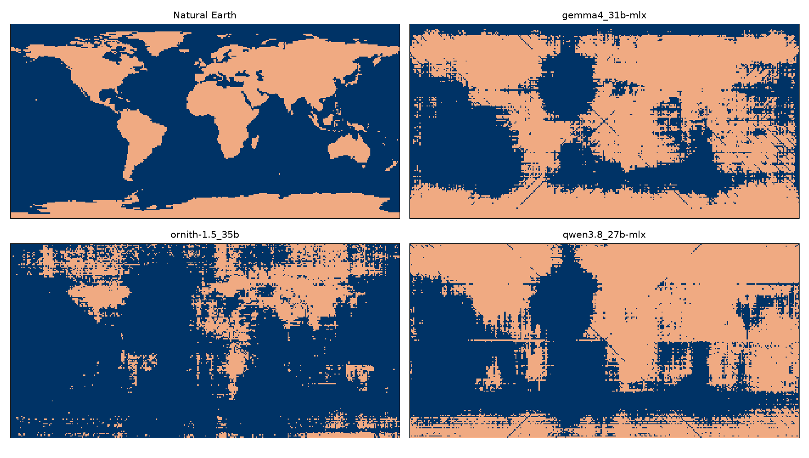

# World map, by Natural Earth and by LLM

LLMs draw the map of the world, one pixel at a time, from memory:

- no tools
- no web search
- no reasoning
- every session starts fresh

Tested with Ollama, but most OpenAI API endpoints should be fine. Example:



Link to Substack article:

https://florinandrei.substack.com/p/how-fuzzy-is-an-llms-knowledge

## Setup

```
python3.14 -m venv .venv
source .venv/bin/activate
pip install -r requirements.txt
```

Create your own `config.toml` based on the example in the repository.

## Download the Natural Earth land polygons

The base map is made from the Natural Earth 1:110m land shapefile (public
domain, https://www.naturalearthdata.com/). It is not in the repository.
Download and unpack it once:

```
./download_data.sh
```

The script needs `curl` and `unzip`. After it runs,
`data/ne_110m_land/ne_110m_land.shp` exists.

## Base map

```
python make_basemap.py            # writes maps/basemap.png
```

A pixel is land when its center is inside a land polygon. Add `--all-touched`
to keep more small islands. The colors come from `config.toml`; use
`--config FILE` to read another file.

## LLM map

```
python llm_map.py                  # first model in config.toml
python llm_map.py --model NAME     # a specific model
python llm_map.py --limit 200      # short test run
python llm_map.py --order random   # partial map samples the whole globe
```

Output goes to `maps/llm_<model name>.png`, with the model name made safe for
file names. White pixels are not answered yet, gray pixels got no usable
answer. Start the script again to continue an unfinished map. Use
`--retry-unknown` to ask again for the gray pixels. To start a model from
scratch, delete its PNG.

The map is saved every `save_interval` seconds (60 by default, or
`--save-interval N`). CTRL-C once: the current request finishes, the map is
saved, the script exits. CTRL-C twice: immediate exit; the answers since the
last save are lost, the file on disk is never left half written.

## Prompt

The prompt is in `prompt.txt`, a plain text file that holds only the prompt.
It is sent as the single user message of a fresh chat for every pixel; there
is no system message and no history. Write `{lat}` and `{lon}` where the
coordinates go. `{lat:.3f}` gives three decimals (Python format syntax).
`{x}` and `{y}` give the pixel column and row. Point `prompt_file` in
`config.toml` at a different file to try another prompt.

## Colors

The four pixel colors are in the `[colors]` table of `config.toml` and both
scripts read them from there. They are chosen to be far apart in grayscale
too, so the map stays readable in black and white and for readers with low
vision.

| pixel     | RGB           | gray |
|-----------|---------------|------|
| blank     | 255, 255, 255 | 255  |
| land      | 240, 170, 130 | 186  |
| unknown   | 115, 115, 115 | 115  |
| sea       | 0, 51, 102    | 42   |

The scripts refuse a color table where two colors are closer than 32 gray
steps. The LLM map stores its state in these exact RGB values. If you change
a color, delete the existing `maps/llm_*.png` files (or recolor them) and run
`make_basemap.py` again.

## Configuration

`config.toml` lists the colors, the prompt file, the endpoints, their models,
and the request parameters that are passed through to the request body as
is. With Ollama, `reasoning_effort = "none"` turns off thinking for Qwen3
models; without it the one-word answer never arrives inside a small
`max_tokens`.
